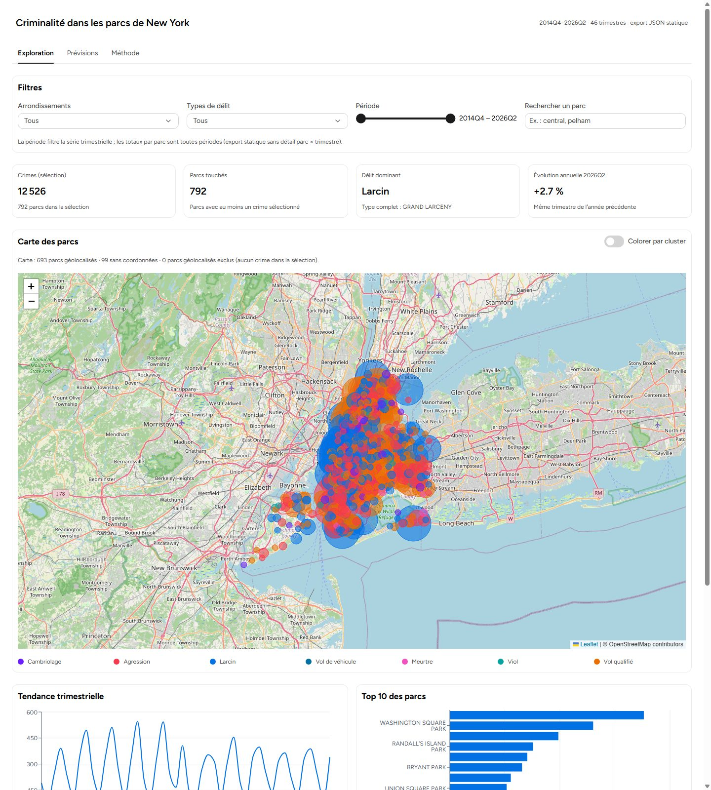

# Criminalité dans les parcs de New York

[](LICENSE)

**Module Open Data, IPSSI · Sujet 2 · Novembre 2026**

**Démo en ligne : [nyc-crimes.vercel.app](https://nyc-crimes.vercel.app)**

Projet complet : téléchargement des données ouvertes du NYPD, entrepôt local,
analyse exploratoire, modélisation de séries temporelles, typologie des parcs
et application interactive. Les chiffres du README et du diaporama sortent des
artefacts produits par le pipeline ; aucun n'est saisi à la main.

## Contexte et objectifs (sujet 2)

Les parcs de New York sont un espace public dense et surveillé ; la police de la
ville publie, trimestre par trimestre, le nombre des sept crimes majeurs
déclarés dans chacun d'eux. Le sujet 2 consiste à transformer ces classeurs
hétérogènes en une analyse reproductible et à répondre à trois questions :

1. **Mesurer.** Quel volume, quelle saisonnalité, quels déséquilibres entre
   arrondissements et types de délit ?
2. **Localiser.** Quels parcs concentrent le risque, une fois la surface prise
   en compte ?
3. **Prévoir.** Un modèle de série temporelle bat-il une règle naïve, et avec
   quelle incertitude ?

## Source des données

| Source | Contenu | Usage |
| --- | --- | --- |
| [NYPD, Park Crime Statistics](https://www.nyc.gov/site/nypd/stats/crime-statistics/park-crime-stats.page) | un classeur Excel par trimestre : par parc, les sept crimes majeurs | série temporelle |
| [NYC Parks Properties](https://data.cityofnewyork.us/) | référentiel des parcs : surface en acres, coordonnées | taux par acre, carte |

- Période couverte : **2014Q4 → 2026Q2**, soit 46 trimestres et 46 classeurs.
- **2020Q1 est absent de la source** : il est interpolé pour la modélisation,
  jamais traité comme un zéro.
- **2026Q3 et 2026Q4 ne sont pas encore publiés** (URL en 404 au moment du
  téléchargement) : la série s'arrête à 2026Q2.
- **Changement de couverture** : Central Park n'apparaît dans les classeurs
  qu'à partir de 2025Q1. Toute comparaison annuelle est donc donnée deux fois :
  avec et sans ce parc (voir `outputs/tables/coverage_gaps.csv`).
- **Anomalie de source** : dans le classeur 2025Q4, Flushing Meadows Corona Park
  affiche un TOTAL de 17 contre 18 pour la somme des sept types ; la ligne est
  exclue de l'entrepôt et journalisée (`outputs/tables/source_anomalies.csv`).

Attribution : données produites par le **NYPD** et la ville de New York,
publiées sur **NYC Open Data** / nyc.gov. Réutilisation à des fins pédagogiques ;
les données restent la propriété de leurs producteurs et ne sont pas modifiées
dans leur fond.

## Données

Les données ne sont **pas versionnées** : `data/raw/` (classeurs NYPD),
`data/processed/` et `data/warehouse.db` sont ignorés par Git (~104 Mo).
Sur un clone neuf, il faut donc reconstruire le pipeline localement :

```bash
make data       # télécharge les classeurs NYPD -> data/raw/
make warehouse  # parse -> data/processed/park_crime_long.csv + data/warehouse.db
```

Seul le sous-ensemble consommé par le tableau de bord est versionné :
`app/web/src/data/*.json` (huit fichiers, < 2 Mo, cubes parc × trimestre × type
et palette inclus). C'est la charge utile du déploiement : le build web n'a
besoin d'aucune donnée Python et le bundle n'embarque qu'une seule copie.

Les agrégats par parc ne sont pas publiés dans Socrata : la découverte se fait
sur la page NYPD (liens stables), avec un manifeste et une vérification
d'empreintes (`data/manifest.lock.json`). L'API Socrata ne sert qu'au référentiel
des parcs. Une page modifiée ou un classeur manquant produit un manifeste
incomplet et un code de sortie non nul au lieu d'un succès silencieux.

## Architecture

```text
data/raw/*.xlsx (NYPD)          NYC Parks Properties (JSON)
        │                                │
        ▼                                ▼
┌────────────────────────────────────────────────┐
│ Téléchargement   etl/download.py                │ sha256 → data/raw/manifest.json
└───────────────────┬────────────────────────────┘
                    ▼
┌────────────────────────────────────────────────┐
│ Entrepôt         etl/parse.py + etl/geo.py      │ data/warehouse.db + data/processed/*.csv
└───────────────────┬────────────────────────────┘
                    ▼
┌────────────────────────────────────────────────┐
│ Analyse          analysis/eda.py                │ outputs/tables/*.csv, outputs/figures/*.png
└───────────────────┬────────────────────────────┘
                    ▼
┌────────────────────────────────────────────────┐
│ Modèles          analysis/model.py              │ prévisions, backtest rolling, clusters KMeans
└───────────────────┬────────────────────────────┘
                    ▼
┌────────────────────────────────────────────────┐
│ Interfaces       app/web (Astryx, statique)    │ export/export_web.py -> JSON
│                  app/app.py (Streamlit)        │ lecture seule des artefacts
└────────────────────────────────────────────────┘
```

Le diaporama (`presentation/nyc_crime_deck.pptx`) est lui aussi généré :
`presentation/build_deck.py` lit les mêmes `outputs/metrics/*.json` et
`outputs/tables/*.csv` à la construction, si bien qu'aucun chiffre n'est
recopié à la main.

## Installation

Prérequis : Python 3.11+ et `make` (sous Windows : `make` via Chocolatey ou
Git Bash). Le projet a été développé et testé avec Python 3.14. L'interface
web demande en plus Node **`^20.19.0 || >=22.12.0`** (exigence de Vite 8.3.8 ;
développée et testée avec Node 26.12.1) ; la chaîne Python, `make all` et
`make test` fonctionnent sans Node.

```bash
make setup      # crée .venv et installe le projet + extras dev (pyproject.toml)
```

## Commandes de reproduction

```bash
make data       # télécharge les classeurs NYPD dans data/raw/ (idempotent, sha256)
make warehouse  # parse les classeurs -> data/processed/park_crime_long.csv + data/warehouse.db
make geo        # rattache surface et coordonnées aux parcs (cache local)
make eda        # tables et figures exploratoires -> outputs/tables, outputs/figures
make model      # backtest, prévisions et clusters -> outputs/metrics
make test       # suite pytest
make deck       # régénère presentation/nyc_crime_deck.pptx
make app        # lance l'application Streamlit sur http://localhost:8501
make all        # data -> warehouse -> geo -> eda -> model -> test -> deck (sans Node)
make web-install  # installe les dépendances de app/web/ (npm ci)
make web-export   # exporte les artefacts Python en JSON statique -> app/web/src/data/
make web-build    # web-export puis npm run build -> app/web/dist/
make web-dev      # serveur de développement Vite (rechargement à chaud)
make all-web      # make all + make web-build
```

`make warehouse` appelle `etl/parse.py --allow-anomalies` : les écarts
TOTAL / somme connus sont écrits dans `outputs/tables/source_anomalies.csv` au
lieu d'interrompre la chaîne. La porte stricte reste le comportement par défaut :
`python etl/parse.py` (ou `--check`) sort en erreur et nomme la ligne fautive.

## Interface web (Astryx)

L'interface principale est un tableau de bord statique (React + Astryx, carte
Leaflet) construit dans `app/web/`. Il ne lit que des JSON exportés depuis les
artefacts Python (`export/export_web.py`) : aucun backend, aucun accès réseau à
l'exécution en dehors des tuiles de carte.

Sur un clone neuf, la chaîne Python doit tourner **avant** le build web :
`export/export_web.py` lit `data/warehouse.db`, `outputs/metrics/` et
`outputs/tables/`. Lancé sans ces artefacts, `make web-build` échoue dans
l'export avec ``export_web: missing .../data/warehouse.db; run `make warehouse`
first`` (exit non nul). Depuis un clone neuf, utiliser `make all-web` (chaîne
Python complète puis build web) ou, en deux temps, `make all` puis
`make web-build`.

```bash
make web-install   # une fois : npm install dans app/web/
make web-build     # exporte les JSON puis construit app/web/dist/
make web-dev       # développement : serveur Vite avec rechargement à chaud
make all-web       # chaîne Python complète (make all) + build web
```

Hébergement : `app/web/dist/` est un site statique, publiable tel quel sur
n'importe quel serveur de fichiers statiques ; en local, `npx vite preview`
(depuis `app/web/`) suffit. `make all` reste sans Node.

Onglets :

- **Exploration** : filtres par arrondissement, type de délit, période et
  recherche de parc. Les quatre indicateurs (crimes de la sélection, parcs
  touchés, délit dominant, évolution) sont recalculés à chaque filtre ; sur
  l'ensemble des sélections, 12 544 crimes au total. Puis carte des parcs
  (option coloration par cluster), tendance citywide ou par arrondissement, top
  parcs, classement des parcs par risque (crimes / 100 acres) et matrice
  arrondissement × type.
- **Prévisions** : backtest rolling contre la règle naïve (MAE moyenne ±
  écart-type, test de Diebold-Mariano), prévisions citywide réconciliées
  2026Q3 → 2027Q2 avec intervalle à 95 %, et limites du modèle.
- **Méthode** : sources, périodes et anomalies de couverture, licence et
  attribution.



## Déploiement Vercel

`vercel.json` décrit un site **statique** : `npm --prefix app/web run build`
puis publication de `app/web/dist/`. Aucun Python ne tourne au build : les JSON
déjà versionnés dans `app/web/src/data/` suffisent (importés par Vite, donc
présents une seule fois dans `dist`).

Depuis le tableau de bord Vercel :

1. importer le dépôt Git ;
2. nommer le projet `nyc-crimes` ;
3. laisser `vercel.json` imposer la commande de build et le dossier de sortie
   (`app/web/dist`).

Ou en ligne de commande depuis la racine du dépôt. Sans liaison explicite,
`vercel --prod` nomme le projet d'après le dossier (`nyc-crime`) ; liez-le
d'abord pour obtenir le nom `nyc-crimes` :

```bash
vercel link --yes --project nyc-crimes
vercel --prod
```

Le site est alors publié sur **[nyc-crimes.vercel.app](https://nyc-crimes.vercel.app)**.

## Vue analyste (Streamlit)

`app/app.py` reste la vue analyste interactive : mêmes filtres et artefacts,
exécutée côté Python (`make app`, http://localhost:8501). Elle sert au contrôle
et à l'exploration fine ; l'interface web est la version publiée.

## Résultats clés

Tous les chiffres ci-dessous sont produits par le pipeline et stockés dans
`outputs/metrics/` et `outputs/tables/`.

| Indicateur | Valeur | Artefact |
| --- | --- | --- |
| Crimes majeurs déclarés (2014Q4–2026Q2) | 12 544 | `eda_stats.json` |
| Pic trimestriel | 2018Q3, 545 crimes | `eda_stats.json` |
| Évolution 2025 vs 2024, avec Central Park | +5,66 % (1 101 vs 1 042) | `eda_stats.json` |
| Évolution 2025 vs 2024, hors Central Park | +0,67 % (1 049 vs 1 042) | `eda_stats.json` |
| Liaison arrondissement × type | χ² = 1182,1 ; ddl = 30 ; p < 1e-200 ; V = 0,137 | `eda_stats.json` |
| Parcs sans crime, moyenne par trimestre | 89,83 % | `eda_stats.json` |
| Parcs touchés au moins une fois | 792 sur 1 155 | `eda_stats.json` |
| Parcs géolocalisés | 1 009 sur 1 155 (87,4 % ; 90,5 % pondéré) | `geo_coverage.csv` |
| Taux par acre | Manhattan 205,4 / 100 acres hors Central Park (146,7 avec) ; Staten Island 2,1 | `rate_by_borough.csv` |
| Backtest rolling (3 origines) | naïve saisonnière retenue : MAE 30,17 ± 7,68 ; SARIMAX 30,88 ; Diebold-Mariano p = 0,90 ; MAPE 12,94 % | `model_metrics.json` |
| Couverture empirique des intervalles 95 % | 100 % (naïve), 91,7 % (Holt-Winters), 66,7 % (GLM de Poisson) | `model_metrics.json` |
| Prévision citywide réconciliée | 2026Q3 → 2027Q2 ; écart moyen +2,92 vs prévision brute | `forecast_city.csv` |
| Typologie des parcs | k = 2 ; silhouette 0,180 ; ARI 0,55 ± 0,34 ; 103 parcs (≥ 20 crimes) | `model_metrics.json` |
| Risque par acre | classement dans `park_risk.csv` (Washington Square Park : 6 678 crimes / 100 acres) | `park_risk.csv` |

Le χ² arrondissement × type reste un résultat descriptif, pas prédictif :
l'association est significative (p < 1e-200) mais le V de Cramér est faible
(0,137) et des effectifs théoriques tombent sous 5 dans certaines cellules.

Valeurs exactes telles qu'écrites dans les artefacts (utile pour vérifier une
citation) :

```text
total_crimes=12544  chi2_statistic=1182.052549  cramers_v=0.137283
selected_model=seasonal_naive  selected_mae=30.1667  selected_mae_sd=7.6848
challenger=sarimax  challenger_mae=30.8782  dm_p=0.9017  selected_mape=12.94
silhouette=0.1795  selected_k=2  ari_mean=0.5455  parks_at_floor=103
reconciled_delta_mean=2.92  parks_ever_hit=792
```

La marche de 2025Q1 reste en grande partie un artefact de couverture : à
périmètre constant, 2025 ne progresse que de 0,67 %, contre 5,66 % avec
Central Park. La prévision citywide est gonflée par le même ajout
(`coverage_gaps.csv`). Le taux par acre honnête est le taux à périmètre
constant (Central Park exclu) : sa série ne couvre que 2025Q1–2026Q2 alors que
ses acres comptent en entier.

## Limites

- **Pas de fréquentation** : le taux par acre mesure l'exposition du parc, pas
  le risque par visiteur.
- **Couverture incomplète** : Central Park depuis 2025Q1 uniquement, 2020Q1
  absent, 2026Q3–Q4 non publiés (`coverage_gaps.csv`).
- **Colonne absente** : q1-2025 et q2-2024 n'ont pas de colonne MURDER ; ces
  cellules sont NULL (`count_missing=1`), exclues des sommes, jamais des zéros.
- **TOTAL incohérent** : Flushing Meadows 2025Q4 (TOTAL 17 vs somme 18) garde
  ses sept composantes, flaggées `total_mismatch` (`source_anomalies.csv`).
- **Déclarations, pas faits établis** : ce sont des plaintes enregistrées ; la
  propension à déclarer varie avec le quartier.
- **Choix de modèle optimiste** : le modèle est sélectionné sur la même fenêtre
  de backtest qu'il rapporte ; seul le comparatif avec la règle naïve est neutre.
- **Géolocalisation** : 12,6 % des parcs sans coordonnées ; les deux
  rapprochements flous audités sont écartés (`data/geo_denylist.csv`) ou
  corrigés par override (`data/geo_overrides.csv`, `geo_false_positives.csv`).
- **Périmètre du modèle** : STATEN ISLAND et BROOKLYN/QUEENS sont exclus de la
  prévision par arrondissement, faute de volume. BROOKLYN/QUEENS est un libellé
  combiné de la source : 5 parcs dans la source, 4 avec au moins un crime.

## Vérifier les chiffres

```bash
make check        # ruff, mypy, tests, couverture, README
make readme-check # les chiffres cités ici face aux artefacts
```

Le README, le deck et le tableau de bord lisent les mêmes fichiers
`outputs/metrics/*.json` ; `scripts/check_readme_numbers.py` échoue dès qu'un
chiffre cité ne correspond plus à l'artefact.

## Confidentialité et tuiles

La carte charge les tuiles OpenStreetMap depuis `tile.openstreetmap.org` : votre
adresse IP et la zone consultée sont visibles du fournisseur de tuiles. Aucune
autre requête réseau n'est faite : le reste de l'application est statique et
les données sont embarquées au build.

## Fichiers volumineux

Le classeur PowerPoint est régénéré par `make deck`, les figures par
`make eda`/`make model`, et les captures par `make e2e` (dossier ignoré). La
capture du tableau de bord est un JPEG compressé (~400 Ko) ; les classeurs NYPD
et l'entrepôt ne sont jamais versionnés.

## English summary

NYC park crime, IPSSI Open Data module, subject 2. Quarterly NYPD park-crime
workbooks (2014Q4–2026Q2, 46 quarters, 12 544 major crimes) are downloaded and
reconciled in a SQLite warehouse; the analysis covers seasonality, borough ×
crime-type association (χ², Cramér's V), per-acre risk, a rolling-origin
forecast with a coverage-break dummy and Diebold–Mariano test, and a stabilised
park typology. The primary interface is a static Astryx/React dashboard (map,
filters, search, shareable URL); Streamlit remains the analyst view. Everything
rebuilds from `make setup && make all-web`; tests run offline with committed
fixtures.

## Structure du dépôt

```text
etl/            download.py (téléchargement + manifeste), parse.py (entrepôt), geo.py (parcs)
analysis/       eda.py (statistiques, figures), model.py (prévisions, backtest, KMeans)
app/            app.py : application Streamlit (filtres, carte, prévisions, méthode)
app/web/        tableau de bord Astryx (React + Vite), interface principale
export/         export_web.py : artefacts Python -> JSON statiques pour app/web
presentation/   build_deck.py, nyc_crime_deck.pptx, script_oral.md
docs/           data_dictionary.md : dictionnaire de données et règles de parsing
outputs/        tables/ (CSV), figures/ (PNG), metrics/ (JSON)
tests/          pytest : ETL, manifeste, géolocalisation, EDA, modèle, helpers de l'app
data/           raw/ (classeurs + manifeste), processed/ (CSV), warehouse.db : non versionnés
```

## Tests

```bash
make test        # ou : python -m pytest -q
```

La suite couvre le manifeste de téléchargement, le parseur (y compris la porte
d'intégrité TOTAL = somme), le rapprochement géographique, les statistiques de
l'EDA, le backtest et les helpers purs de l'application.

## Licence et données

Le code de ce dépôt est publié sous [licence MIT](LICENSE) : réutilisation,
modification et redistribution libres, avec conservation de la notice de
copyright.

Les données ne sont pas couvertes par cette licence. Elles restent la propriété
de leurs producteurs et sont diffusées par la ville de New York selon les
[conditions d'utilisation de NYC Open Data](https://opendata.cityofnewyork.us/overview/#terms) :

- [NYPD, Park Crime Statistics](https://www.nyc.gov/site/nypd/stats/crime-statistics/park-crime-stats.page) — © City of New York / NYPD ;
- [NYC Parks Properties](https://data.cityofnewyork.us/Recreation/Parks-Properties/enfh-gkve) — © City of New York / NYC Parks.

Le dépôt ne fait que lire ces sources ; aucun contenu n'est modifié dans son
fond.
